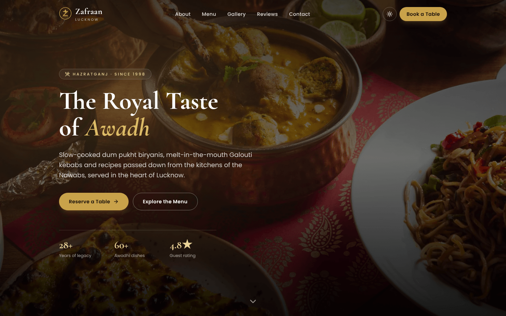
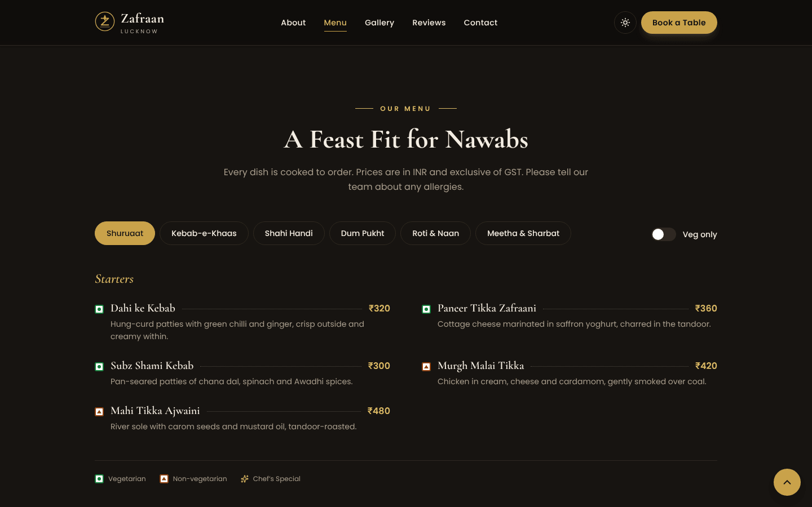
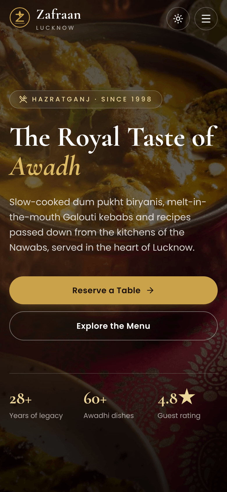
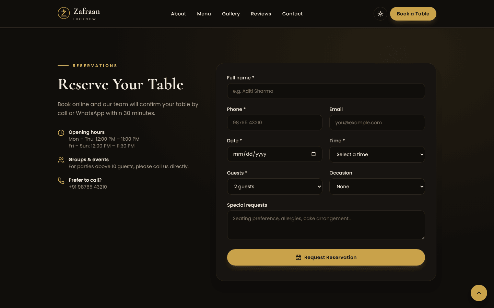
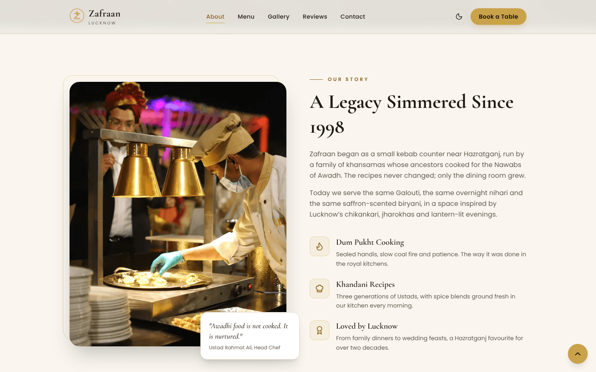

# Zafraan | Royal Awadhi Restaurant Website

A modern, responsive website for **Zafraan**, a (fictional) fine-dining Awadhi restaurant in Hazratganj, Lucknow.
Built as a portfolio / client-style sample with React, Vite and Tailwind CSS v4, deployed on Netlify.

🔗 **Live demo:** https://zafraan-lucknow.netlify.app


<!-- Screenshot yahan add karo: docs/screenshot-hero.png -->

## ✨ Features

- **Mobile-first, responsive design** with a premium dark theme and a light-mode toggle (saved per visitor)
- **Menu** with 6 categories, veg / non-veg (FSSAI-style) markers, prices in ₹, a "Veg only" filter and Chef's Specials
- **Gallery** of 7 photos in a masonry layout with a keyboard-accessible lightbox
- **Reservation form** powered by **Netlify Forms** (no backend), with honeypot spam protection and validation
- **Contact** section with Google Maps embed, directions and WhatsApp links
- **SEO:** meta tags, Open Graph / Twitter cards, JSON-LD `Restaurant` schema, sitemap and robots.txt
- **Accessibility:** semantic HTML, skip link, alt text, focus states, ARIA labels, reduced-motion support
- **Performance:** WebP images optimized with `sharp` (~550 KB for all photos), lazy loading, hero preload, long-term cache headers

## 📸 Screenshots

| Desktop | Mobile |
|---|---|
|  |  |
|  |  |

<!-- docs/ folder banao aur screenshots yahan daalo -->

## 🛠 Tech Stack

React · Vite · Tailwind CSS v4 · lucide-react · Netlify (hosting + Forms) · sharp (image optimization)

## 📁 Project Structure

```
src/
  components/   UI sections (Hero, Menu, Gallery, Reservation...)
  data/         Restaurant content: site info, menu, reviews, gallery
  hooks/        Theme, scroll-reveal, active-section
scripts/        Image optimization script
public/         Static assets, optimized images, SEO files
```

All restaurant content lives in `src/data/`, so the site can be re-branded for a new client by editing data files only.

## 🚀 Run Locally

```bash
npm install
npm run dev        # development server
npm run optimize   # convert images-src/* to optimized WebP in public/images
npm run build      # production build
npm run preview    # preview the production build
```

## ☁️ Deployment

Deployed on Netlify from GitHub. Build settings are in `netlify.toml`:
- Build command: `npm run build`
- Publish directory: `dist`

Enable **Forms → form detection** in the Netlify dashboard to receive reservations.

## 🖼 Credits

- Photos: [Unsplash](https://unsplash.com) (free Unsplash License)
- Fonts: Cormorant Garamond & Poppins (Google Fonts)
- Icons: [Lucide](https://lucide.dev)

> **Note:** Zafraan is a fictional restaurant created for demonstration purposes. Address, phone number and reviews are sample content.

---

Designed & developed by **Shiv Kumar**. Available for restaurant, café and small-business websites.